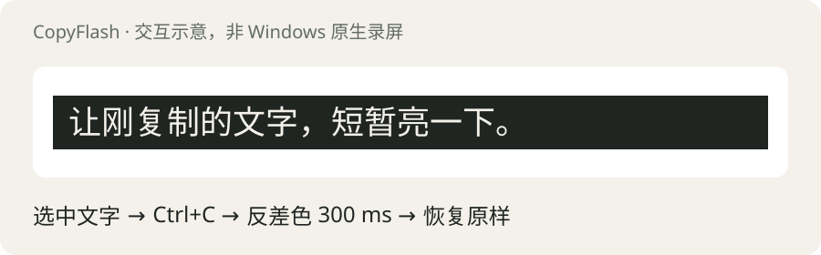

# CopyFlash · 闪拷

**按完 Ctrl+C，让刚复制的文字短暂反色。**

Windows 托盘工具，0.1.0 实验版。支持获取选区位置的程序中显示原文反色；其他程序回退为简短的剪贴板提示。兼容性仍需逐个软件验证。

下载入口：[GitHub 预览版 Releases](https://github.com/FFailing/copyflash/releases)。请使用标有“实验版 / Pre-release”的 Windows x64 便携包。



## 怎么用

1. 解压 Windows 便携包，运行 `CopyFlash.exe`，会打开实验窗口并在托盘常驻。不需要管理员权限。
2. 在软件里选中文字，照常按 Ctrl+C，或使用右键复制。
3. 复制产生前台程序的文字剪贴板更新后，尝试短暂反色选区，默认 300 ms。
4. 双击系统托盘图标打开实验窗口；右键托盘可暂停、选择 300 / 600 / 900 ms，或退出。

`CopyFlash.exe --demo` 同样打开实验窗口；`CopyFlash.exe --tray` 仅在托盘启动。关闭实验窗口后程序仍在托盘；退出托盘程序后停止监听。当前设置只保留至本次退出；没有安装服务、开机启动项或浏览器扩展。

## 为什么是软件

浏览器插件主要覆盖网页。Windows 全局反馈更适合由一个常驻托盘进程处理。本工具订阅 Windows 的剪贴板更新通知，**不拦截、不重发 Ctrl+C，也不接管系统复制动作**。

收到前台进程产生的 Unicode 文字更新后，使用 UI Automation 的 `TextPattern.GetSelection()` 和 `GetBoundingRectangles()` 尝试取得选区位置。获取成功时，在这些位置短暂显示选区像素的反色副本；浮层不抢键盘焦点、鼠标可以穿透。离开前台、窗口移动、按 Esc 或鼠标左键时会取消显示。

UI Automation 查询由短时辅助进程处理，查询超时会结束辅助进程并回退提示，不阻塞托盘消息循环。辅助进程与主程序来自同一个 exe。

## 首版范围与限制

- 主要目标：Windows 10 / 11 x64，需系统 .NET Framework 4.8 环境；当前源码使用系统 .NET Framework 编译器构建。
- **不能保证所有软件都有原文闪色。** 不暴露 TextPattern 的控件、部分 PDF、终端、自绘画布、游戏和高权限窗口可能只能回退提示，或没有反馈。
- 仅处理前台进程作为剪贴板所有者的 Unicode 文字更新。后台同步、所有者不明、图片或文件复制会跳过，避免把更新标到错误的窗口。
- 剪切等操作也可能产生文字剪贴板更新；首版并不把通知严格等同于 Ctrl+C。
- 复制相同内容时，是否触发取决于原软件是否重新写入剪贴板；纯内部复制、不写系统剪贴板的程序不触发。
- 只显示可见选区，单次最多 48 个矩形、800 万像素。原文仍保持原软件的选中状态。
- 反色来自短时像素副本，不会改变文档格式。播放中的画面可能在该小区域短暂停住；它不是对目标软件内部文本样式的修改。
- 单次辅助进程启动和应用的无障碍提供程序会影响延迟；没有发布“零延迟”或全应用兼容的性能承诺。
- 首版没有代码签名证书；此仓库发布的预览版不得宣传为已通过微软签名、商店审核或全量兼容认证。
- 本地验证记录见 `docs/VALIDATION.md`。没有实际验证过的软件不会列为已支持。

## 隐私

不调用 `GetClipboardData`，不读取或保存剪贴板正文，不记录复制历史，不联网，不上传遥测。只检查文字格式、来源进程和剪贴板序号。反色所需的选区屏幕像素只在内存里临时处理，并在闪色结束后释放；不会写成截图文件。密码控件若由 UI Automation 标识为密码则跳过。

## 从源码构建

在 Windows x64 PowerShell 中：

```powershell
./build.ps1
./dist/CopyFlash.exe --demo
```

无需 NuGet 包或第三方运行库。编译器路径为 Windows 系统目录下的 `.NET/Framework64/v4.0.30319/csc.exe`，输出程序、说明、许可证及 SHA256 清单。

运行基础自检并检查退出码：

```powershell
$testProcess = Start-Process -FilePath './dist/CopyFlash.exe' -ArgumentList '--self-test' -Wait -PassThru
if ($testProcess.ExitCode -ne 0) { throw 'CopyFlash self-test failed' }
```

自检覆盖反色算法、矩形裁剪与去重、异常坐标与像素限制、剪贴板监听的注册和注销。应用兼容性、跨进程复制及缩放显示还须人工验证。

## 开发方向

先完善真实应用的兼容性记录和缩放测试，再评估可选的浏览器扩展，以提供更准确的网页选区反馈。当前没有发布扩展或安装器。

## Windows API 参考

- [AddClipboardFormatListener](https://learn.microsoft.com/en-us/windows/win32/api/winuser/nf-winuser-addclipboardformatlistener)
- [TextPattern.GetSelection](https://learn.microsoft.com/en-us/dotnet/api/system.windows.automation.textpattern.getselection)
- [TextPatternRange.GetBoundingRectangles](https://learn.microsoft.com/en-us/dotnet/api/system.windows.automation.text.textpatternrange.getboundingrectangles)

## English

CopyFlash is an experimental Windows tray utility providing brief inverted-color feedback after foreground text clipboard updates. It preserves the ordinary copy workflow. Exact selection feedback depends on the app's UI Automation support; unsupported apps receive a small clipboard notice instead. Clipboard text is never retrieved, stored, or uploaded. The transient overlay uses selected screen pixels in memory only. MIT licensed.

